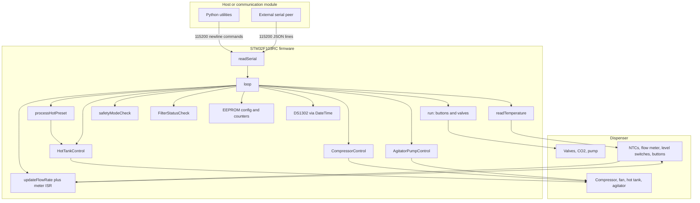

# DaVinci 20 Plus controller firmware

Main controller firmware for the DrinkStation DaVinci beverage dispenser. The startup log identifies the image as `DRINKSTATION DaVinci 3.2 DEVELOPMENT KIT`. Status JSON reports model `Davinci 2.0` and version `2.1` (`firmwareVersion` in `src/main.cpp`). `src/main.h` also defines `MODEL` (`DAVINCI20PLUS`) and `VERSION` (`1.6`); those two symbols are not referenced elsewhere in this tree.

Commits in this repository are authored by John Tsai. The 2025 history describes an upgrade of features from a prior `da2021` tree onto this STM32 Arduino / PlatformIO project.

The firmware is the real-time machine layer: dispensing, thermal control, pumps and valves, flow measurement, filter tracking, button and LED UI, a DS1302 real-time clock, and a serial JSON command interface. The ice-bank and hot-tank paths are fixed-threshold controllers plus compile-time NTC lookup tables. Nothing in those files, and nothing in the git history of this repository, updates a coefficient, fits a curve, or runs an inference runtime.

## Hardware platform

Configured in `platformio.ini`:

| Item | Value in this repo |
| --- | --- |
| Platform | `ststm32` |
| Board | `genericSTM32F103RC` |
| Core | `arduinoststm32-maplecompgecompile` |
| Framework | Arduino |
| Upload / debug | ST-Link (`upload_protocol = stlink`, `debug_tool = stlink`) |
| Upload port | `ttyACM0` |
| Serial monitor | 115200 baud, `monitor_dtr = 1` |
| USB | CDC enabled (`PIO_FRAMEWORK_ARDUINO_ENABLE_CDC`, `USBCON`) |

USB identity set by the build flags: VID `0x1E29`, PID `0x0406`, manufacturer `Unknown`, product string `BLUEPILL_F103C8`. The product string names a different STM32F103 density than the `genericSTM32F103RC` board entry.

Flash size, SRAM size, and core clock are not recorded in this repository.

<!-- TODO: add measured flash and SRAM from the PlatformIO linker report, and the core clock actually programmed on the board -->

### I/O used by the firmware

Direct GPIO from `src/main.h`, `src/temp_read.h`, `src/DateTime.h`, and the control classes:

| Function | Pin |
| --- | --- |
| Cold NTC, hot NTC, third NTC | `PA0`, `PA1`, `PC1` |
| Ice and hot-level analog inputs (sampled, not converted to a published temperature) | `PC2`, `PC3` |
| Flow-meter interrupt (rising edge) | `PC0` |
| Water pump, agitator, compressor, fan, hot tank | `PA9`, `PA10`, `PA8`, `PC14`, `PA15` |
| CO2 valve | `PC13` |
| Buttons: yellow, white, blue, green, red, filter | `PC5`, `PB0`, `PB1`, `PB2`, `PB10`, `PB11` |
| Child-safety switch | `PB12` |
| Chiller level switches | `PB4` (upper, read), `PC4` (defined) |
| DS1302 clock, I/O, chip enable | `PC6`, `PC7`, `PC8` |
| 74HC595 serial data, clock, latch | `PB13`, `PB15`, `PB14` |

Two cascaded 74HC595 devices (`ShiftRegister74HC595<2>`) drive valve and LED outputs. Indexes actually written by the valve and LED helpers include cold `15`, hot `14`, level `13`, main `12`, sparkling `11`, nozzle `10`, alkaline `8`, and the button and status LEDs on indexes `0` through `7`. `NO_V` (index `9`) is defined and not written. `OUTPUT3` through `OUTPUT7` (`PB9`–`PB5`) are configured as outputs in `initializePins()` and have no further references in `src/`.

`Serial2.begin(115200)` and `SerialUSB.begin(115200)` both accept line-oriented commands. The `HardwareSerial Serial2(PA3, PA2)` constructor in `src/main.cpp` is commented out, so this tree does not assign UART pins in source.

## System architecture

`loop()` in `src/main.cpp` is the control cycle. It reads temperatures, runs button and dispense logic (`run()`), advances the hot-preset state machine, checks the child-safety switch and chiller level, runs the agitator, reads serial commands, applies volume and low-flow safety checks, updates flow, and then runs filter, hot-tank, and compressor control.



`docs/map.md` sketches a larger AquaMesh layout in which an ESP32 communication module sits on the serial/JSON link and a separate path handles firmware update. That ESP32 module, Wi-Fi, MQTT, and a bootloader bridge are not implemented in this firmware.

### Operating modes

`SystemMode` in `src/main.h`:

| Mode | How this tree uses it |
| --- | --- |
| `manual` | Default. Green dispenses sparkling, blue dispenses cold, white dispenses alkaline. |
| `autofill` | Yellow held past `autofillButtonPressTime` (2000 ms). Stops when the flow total reaches the requested volume, or after 5000 ms with no dispense. |
| `calibrate` | Yellow held past `calibrationModeButtonPressTime` (5000 ms) while the green button LED is on. A dispense stops at a fixed volume count (below). |
| `configuration` | Button LEDs flash. Yellow toggles the hot-water safety sequence. |
| `hotTankConfig`, `chillerBucketConfig` | Setpoint changes from the button UI. |
| `chillerBucketRefill` | Compressor and agitator are forced off. Blue and white held together for 3000 ms open the main and level valves. |
| `hotWaterDispense` | Hot-water button sequence, the `auto*` and `remoteauto*` commands, and hot presets. The `auto*` commands set this mode even when the water type is sparkling, cold, or alkaline. Returns to `manual` 5000 ms after the sequence start if no dispense is active. |
| `thirtysecs` | Entered from a manual pour once `currentTime - 30000 > dispenseStartTime`. After 200 ms, CO2 and the water pump are turned off and the mode returns to `manual` when the buttons are released. |
| `safety` | Stops the pour, flashes the green and red status LEDs, and turns CO2 and the water pump off after 200 ms. |

Hot water, when `isHotWaterSafetySequenceEnabled` is true, follows a red, then yellow, then red press sequence. Each step must arrive within `hotWaterSequenceTimeout` (5000 ms). A low read on the child-safety switch (`PB12`) sets `isChildSafetySwitchEnabled` and the red-button handler returns immediately.

### Dispense outputs

| Water | Actuators turned on |
| --- | --- |
| Sparkling | Main, sparkling, and nozzle valves, plus the agitator. CO2 valve and water pump follow after 200 ms while the button, autofill, calibration, auto-dispense, or remote hold is still asserted |
| Cold | Cold valve, main valve, and agitator; water pump after 200 ms on the same hold conditions |
| Alkaline | Alkaline valve, main valve; water pump after 200 ms |
| Hot | Main valve and hot valve. The last hot-dispense epoch is written to EEPROM |

Remote holds (`holdSparkling`, `holdCold`, `holdAlkaline`) and `isAutoDispensing` keep the matching pump path asserted the same way a held button does.

### Thermal control

Ice-bank temperature is `ntc.cold_ntc`, the cold NTC on `PA0`. The compressor does not read `ICE_PIN` (`PC2`). That pin is averaged inside `readTemperature()` and then discarded. Hot-tank temperature is `ntc.hot_ntc` from `PA1`. Both temperatures are refreshed every 5000 ms. `src/temp_read.cpp`, `src/CompressorControl.cpp`, and `src/HotTankControl.cpp` are unchanged since commit `2259a47` ("Upgrading features from da2021"). This repository has no other branch that carries different thermal code.

**Ice bank / compressor** (`CompressorControl::run`, called from `loop()` when `isCompressorControlEnabled` is true and the mode is not `chillerBucketRefill`). Outputs are compressor `PA8` and fan `PC14`, switched together.

The law is a deadband with a 60000 ms confirmation. It does not compute a slope, integral, or prediction.

- While `ntc.cold_ntc > ChillerBucketMax`, the first sample latches `compressorCrossUpperLimitTime`. When `millis()` passes that latch by 60000 ms, and the compressor is off, compressor and fan turn on.
- While `ntc.cold_ntc < ChillerBucketMin`, the same 60000 ms latch turns both off.
- While the reading is between the two limits, both latches clear and the outputs stay as they are.

**Hot tank / heater** (`HotTankControl::run`, called from `loop()` only when `isHotTankEnabled`). Output is `PA15`.

- `ntc.hot_ntc > HotTankMax` turns the heater off immediately.
- `ntc.hot_ntc < HotTankMin` turns the heater on immediately.
- A reading between the limits leaves the heater as it is.

`HotTankControl::runPostDispense` ignores `HotTankMin`. It turns the heater on when `ntc.hot_ntc < HotTankMax`, and off when the reading is above `HotTankMax` and below `HotTankMax + 3`. `checkLastHotWaterDispenseDateTime()` calls it when `getEpochTime() - 120` is not greater than `lastHotWaterDispenseTime` (the dispense is 120 seconds old or newer). `loop()` then calls `run()`, so a reading above `HotTankMax` still ends the iteration off, and a reading strictly inside the min/max band is forced on for that 120 second window.

The same function flashes the red button LED when `getEpochTime() - lastHotWaterDispenseTime` exceeds 2592000 seconds (30 days). The following `else if` uses 2678400 seconds (31 days) and would disable the heater, but any age past 31 days is already past 30 days, so that branch does not execute.

**Setpoints.** `getCurrentTempConfig()` loads `TempConfig` from EEPROM address 0. `temp write` stores it back. The `setchillerbucket*` and `sethottank*` commands, and the config-mode button handlers, change the RAM copy only. Named bands in `handleSetChillerBucketTempCommand` and `handleSetHotTankTempCommand`, which the log text labels °C:

| Name | Chiller max / min | Hot max / min |
| --- | --- | --- |
| `default` | 0.4 / -1.8 | 88 / 85 |
| `lesscold` / `lesshot` | 0.5 / -1.0 | 85 / 82 |
| `coldest` / `hottest` | 0.3 / -2.1 | 91 / 88 |
| `saving` | 1 / -0.4 | 83 / 78 |

`handleTempCommand("lesscold")` has an empty body. `cold_saving` in that function uses the same chiller pair as `saving`. In `chillerBucketConfig`, green selects `default`, blue `coldest`, white `lesscold`, and red `saving`. In `hotTankConfig`, green selects `default`, blue `saving`, white `lesshot`, and red `hottest`. Blue released from `configuration` enters chiller config. Red released from `configuration` enters hot-tank config.

**Hot presets.** `blacktea` stores the current hot limits, sets a target of 90 and a volume integer of 280 (clamp 1500), and enters `HotPresetHeating`. `cupnoodle` does the same with 96 and 300. `processHotPreset()` enables the heater and, once `ntc.hot_ntc >= presetTargetTempC`, calls `autofillHotWater()`. It does not write a new `HotTankMax`. `HotTankControl::run` still turns the heater off above the stored max, so a target above that max is not held by the heater loop. On hot-water stop, the saved limits are copied back.

**Agitator and filter.** `AgitatorPumpControl::run` runs the agitator 120000 ms on and 1800000 ms off. `FilterStatusCheck` marks the filter not ok above 5000000 mL or when `getEpochTime() - lastFilterResetTime` exceeds 15552000 seconds (180 days). The green status LED flashes while the filter is not ok.

### Sensing

**Temperature.** Every 5000 ms, `readTemperature()` reads five ADC channels. `analogReadResolution(12)` is set inside `ADC_RD()`, which sums 200 conversions and divides by `read_number / 4` (50). Ten of those results are reduced by `maxminaverage(..., 10, 6)`, which sorts the window and averages the middle four samples. Cold and the third NTC use `temp_change_cold`; the hot NTC uses `temp_change_hot`. The returned integer is divided by 100 before it is stored.

Each converter is a fixed piecewise-linear lookup, not an online fit. The tables are `const` and have no writer in this tree. Comments label index 0 as -20°C and index 140 as 120°C. Between `table[i]` and `table[i + 1]` the code interpolates one degree:

```text
dd = ((adc - table[i]) * 100) / (table[i + 1] - table[i]) + (i - 20) * 100
```

An ADC count below `table[0]` returns -10000, stored as -100, which `systemCheck()` reports as a missing sensor. A count at or above `table[121]` returns 20000, stored as 200.

The three tables are `tem_dat_cold`, `tem_dat_hot`, and `tem_dat`, 141 `unsigned int` entries each, and all three differ in every entry. At the 32-bit `unsigned int` width of the Arm target selected by `genericSTM32F103RC`, that is 141 × 4 × 3 = **1692 bytes**. `tem_dat` has no caller. `tem_dat_cold` is constant 11373 from index 70 (comment: 50°C) through index 140, so every cold-path count at or above 11373 takes the 20000 sentinel. `tem_dat_hot` keeps increasing through index 140 (value 12108). This size is counted from source, not from a linker map. The ice and hot-level channels are averaged into local variables and not stored.

**Flow.** `FlowMeter` is constructed on the `PC0` interrupt with `FHKCS_1mm_0deg`:

```text
capacity 0.4, kFactor 39.7
mFactor {1.0, 0.995, 0.9925, 0.992, 0.9925, 0.994, 0.995, 0.9975, 1.00125, 1.006}
```

The vendored FlowMeter header documents `capacity` as L/min, `kFactor` as (pulses/s) / (L/min), and `getCurrentFlowrate()` / `getTotalVolume()` as L/min and liters. `updateFlowRate()` calls `tick(period)` with `period` = 100 ms. `minimumFlowRate` is 0.1 in those library units.

Autofill stop volumes are computed as `getTotalVolume() * 10000 + volume`. The preset comments call 280 and 300 milliliters, while the library documents liters, so the same integer is not given a single unit in this repository. Safety compares that scaled total with 2050 (normal dispense), 2000 (calibration), 8000 (chiller refill, float-sensor check), and 11000 (chiller refill). The low-flow path is written as `currentTime - 8000 == dispenseStartTime` and `currentFlowrate < minimumFlowRate`, excluding chiller refill and hot-water dispense.

**RTC and EEPROM.** An Erriez DS1302 driver supplies date, time, and epoch. `setup()` lays out EEPROM as `TempConfig` (two `float`s and two `int`s), then `lastHotWaterDispenseTime`, `totalDispenseVolumeSinceFilterReset`, `lastFilterResetTime` (each an `int`), then `isSerialInJsonMode` (`bool`). With 4-byte `float` and `int` and a 1-byte `bool`, and no padding inside `TempConfig`, `usedEepromSize` is 16 + 4 + 4 + 4 + 1 = **29 bytes**. Factory reset writes that span to 0, stores the current epoch and a JSON-mode flag, applies default temperatures, and calls `NVIC_SystemReset()`.

### Serial interface

Commands are a single line. The first word is matched without case sensitivity. Arguments follow one space. Recognized words:

`iot`, `temp`, `setchillerbucketmax`, `setchillerbucketmin`, `sethottankmax`, `sethottankmin`, `setchillerbuckettemp`, `sethottanktemp`, `flowmeter`, `autospk`, `autocold`, `autoalk`, `autohot`, `remoteautocold`, `remoteautoalk`, `remoteautospk`, `setsparklingwaterautofillvolume`, `setcoldwaterautofillvolume`, `setalkalinewaterautofillvolume`, `setdatetime`, `setepochtime`, `enablehottank`, `getdispensestats`, `factoryreset`, `getmachinestatus`, `dispensesparklingwater`, `dispensecoldwater`, `dispensealkalinewater`, `dispensehotwater`, `resetfilter`, `enablewaterpump`, `enablecompressor`, `enablecompressorcontrol`, `enablewaterpumpcontrol`, `enableHotWaterSafety`, `blacktea`, `cupnoodle`.

`remoteautocold` and `remoteautoalk` set `hotWaterDispense` and call `autofillSparklingWater`, passing `autofillVolume.coldVolume` and `autofillVolume.alkVolume`. `remoteautospk` calls the same function with `autofillVolume.spkVolume`.

`getmachinestatus` replies with one JSON object on `Serial2` and on `SerialUSB`. The document is a `StaticJsonDocument<2048>` (2048-byte ArduinoJson capacity). Alkaline water is reported under `ambientWater*` keys. The object includes per-water pour totals, NTC and setpoint temperatures, autofill volumes, actuator and button state, valve state, flow, float-sensor state, RTC time, model, version, and mode. `machine_status.csv` is a host capture of that object. Its `currentSystemTime` field is `Sunday 1 January 2000 0:00:00`, so the file is a raw log rather than a controlled measurement run.

Default autofill volumes in `AutofillVolume` are the numeric values 250, 250, and 250 for sparkling, alkaline, and cold.

## Build and flash

[PlatformIO](https://docs.platformio.org/) with the `ststm32` platform and an ST-Link on `ttyACM0`:

```bash
pio run
pio run -t upload
pio device monitor
```

`lib_deps` pulls `simsso/ShiftRegister74HC595@^1.3.1` and `bblanchon/ArduinoJson@^6.18.0`. Copies of ShiftRegister74HC595, FlowMeter, and ErriezDS1302 are also vendored under `lib/`. Each vendored library carries its own license. This repository root has no license file.

`setDateTime.py` is written as a PlatformIO extra script (`Import("env")`). The `extra_scripts` line in `platformio.ini` is commented out, so a normal `pio run` does not execute it. The other Python tools open `/dev/ttyUSB0` at 115200 8N1 and send `getmachinestatus`:

| Script | Role in source |
| --- | --- |
| `getMachineStatus.py` | Print every field of a `getmachinestatus` object |
| `getNTC.py` | Print `chillerBucketCurrentTemp` from that object |
| `getNTC2.py` | Plot `ntcOneCurrentTemp` and `ntcTwoCurrentTemp`. The current firmware status object does not emit those keys |
| `gui.py` | PySimpleGUI window; appends rows to `machine_status.csv` |
| `setDateTime.py` | Send `setdatetime` from the host clock, then `factoryreset` |
| `getMachineStatusTB.py` | Forward status with a ThingsBoard device MQTT client |

Broker address and access token for that last script are hardcoded in the file and are omitted here.

## Results / Metrics

Values below are taken from source constants or counted from them. Cells marked TBD are not derivable from this repository.

<!-- TODO: add measured loop iteration time -->
<!-- TODO: add measured flash and SRAM from the linker report -->
<!-- TODO: add measured board power or current -->
<!-- TODO: add measured NTC error against a reference thermometer -->
<!-- TODO: add measured dispense-volume error against a graduated vessel -->
<!-- TODO: add measured inference latency, accuracy, and RAM or flash if an on-device model is added -->

| Metric | Value | Where it comes from |
| --- | --- | --- |
| Status JSON version | 2.1 | `firmwareVersion`, copied into `getmachinestatus` |
| Status JSON model string | Davinci 2.0 | `handleGetMachineStatusCommand` |
| Startup log string | DRINKSTATION DaVinci 3.2 DEVELOPMENT KIT | `startSerial()` |
| Unused version macro | 1.6 | `#define VERSION` in `src/main.h`, no references |
| JSON document capacity | 2048 bytes | `StaticJsonDocument<2048>` |
| NTC lookup tables | 1692 bytes | 3 × 141 × 4, 32-bit `unsigned int` assumed for this board |
| EEPROM image used by `setup()` | 29 bytes | `TempConfig` plus three `int`s and one `bool` |
| Temperature update period | 5000 ms | `readTemperature()` |
| ADC width and samples per channel per update | 12-bit; 200 reads inside `ADC_RD`, repeated 10 times, then a trimmed mean of 4 | `temp_read.cpp`, `readTemperature()` |
| Flow integration period | 100 ms | `period`, `updateFlowRate()` |
| Flow sensor capacity / k-factor | 0.4 L/min, 39.7 (pulses/s)/(L/min) | `FHKCS_1mm_0deg` and the FlowMeter header comments |
| Low-flow threshold | 0.1 in `getCurrentFlowrate()` units (L/min per the library header) | `minimumFlowRate` |
| Compressor on/off delay | 60000 ms past the chiller limit | `CompressorControl::run` |
| Agitator on / off | 120000 ms / 1800000 ms | `AgitatorPumpControl::run` |
| Filter volume / age limits | 5000000 mL, 180 days | `filterReplaceVolume`; 15552000 seconds / 86400 |
| Default chiller limits | max 0.4°C, min -1.8°C | `temp default` |
| Default hot-tank limits | max 88°C, min 85°C | `temp default` |
| Black-tea preset | 90°C, volume integer 280, clamp 1500 | `handleBlackTeaCommand` |
| Cup-noodle preset | 96°C, volume integer 300, clamp 1500 | `handleCupNoodleCommand` |
| Manual pour forced off CO2 and pump | after 30000 ms, then 200 ms in `thirtysecs` | `safetyModeCheck`, `run` |
| Hot-sequence step timeout | 5000 ms | `hotWaterSequenceTimeout` |
| Loop iteration time | TBD | Not measured in this repo |
| Firmware flash usage | TBD | Not measured in this repo |
| Firmware SRAM usage | TBD | Not measured in this repo |
| Board power or current | TBD | Not measured in this repo |
| NTC accuracy | TBD | Tables are present; no calibration report is stored |
| Dispense volume accuracy | TBD | No measured error is stored |
| On-device model size, tensor arena, latency, accuracy | Not applicable | Ice-bank and hot-tank code is a fixed deadband plus NTC tables. No learned parameters are stored or updated |

## Project layout

```text
src/                  Controller firmware
  main.cpp            Control loop, modes, serial commands, dispense
  CompressorControl.* Chiller compressor and fan
  HotTankControl.*    Hot-tank output
  AgitatorPumpControl.*
  FilterStatusCheck.*
  temp_read.*         ADC sampling and NTC tables
  DateTime.*          DS1302
  Button.*  Led.*
  AppTypes.h          NTC and TempConfig
lib/                  Vendored FlowMeter, ShiftRegister74HC595, ErriezDS1302
docs/map.md           AquaMesh sketch
platformio.ini
getMachineStatus.py  getMachineStatusTB.py  getNTC.py  getNTC2.py
gui.py  setDateTime.py
machine_status.csv    Captured getmachinestatus rows
test/  include/       PlatformIO placeholder directories
```

`include/` and `test/` contain the stock PlatformIO directory notes. No unit tests are checked in.
